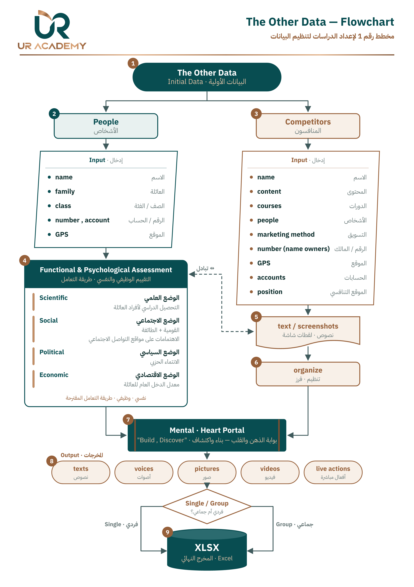

# The Other Data — UR ACADEMY

استمارة **مخطط رقم 1 لإعداد الدراسات لتنظيم البيانات**، مصمّمة للهاتف أولاً وتعمل كتطبيق (PWA).

## ما الذي تفعله

| القسم | الوظيفة |
|---|---|
| 👤 **الأشخاص** | البيانات الأساسية + التقييم الوظيفي والنفسي (العلمي، الاجتماعي، السياسي، الاقتصادي) + نصوص ولقطات شاشة |
| 🏁 **المنافسون** | الاسم، المحتوى، الدورات، الأشخاص، طريقة التسويق، الرقم وصاحبه، الموقع، الحسابات، **الموقع التنافسي** |
| 💬 **المساعد (DeepSeek)** | ترسل نصوصاً حرة، فيرتّبها في حقول الاستمارة ويخبرك ماذا سُجّل، وما الحقل التالي، وما يمكن تركه. عند الاكتمال تراجع السجل وتضغط **موافقة** |
| 🚪 **البوابة** | Mental · Heart Portal: نص، صوت، صورة، فيديو، فعل مباشر، لشخص واحد أو مجموعة (Build / Discover) |
| 🗂 **السجلات** | بحث وتعديل وحذف، وتصدير كل شيء إلى **Excel (XLSX)** |

## الخصوصية

- كل السجلات والصور تُحفظ **على الجهاز نفسه فقط** (داخل المتصفح). لا يوجد خادم ولا قاعدة بيانات.
- لنقل البيانات بين الأجهزة: القائمة ← **نسخة احتياطية** ثم **استرجاع** على الجهاز الآخر.
- المساعد يرسل ما تكتبه في المحادثة إلى DeepSeek فقط. مفتاح API يُحفظ على جهازك ولا يوجد في هذا المستودع.

## تشغيل المساعد

1. أنشئ مفتاحاً من [platform.deepseek.com](https://platform.deepseek.com/api_keys).
2. في التطبيق: القائمة ☰ ← **إعدادات DeepSeek** ← الصق المفتاح ← **اختبار الاتصال** ← **حفظ**.

## التثبيت على الهاتف

افتح الرابط في Chrome (أندرويد) أو Safari (آيفون) ثم **إضافة إلى الشاشة الرئيسية**؛ يعمل بعدها كتطبيق، ويفتح بدون إنترنت (عدا المساعد).

## الملفات

- `index.html`: التطبيق كاملاً (ملف واحد، بدون مكتبات خارجية)
- `The_Other_Data_Flowchart.*`: المخطط رقم 1 (PDF للطباعة A4، PNG، SVG)
- `manifest.webmanifest`, `sw.js`, `icons/`: تثبيت التطبيق والعمل بدون إنترنت
